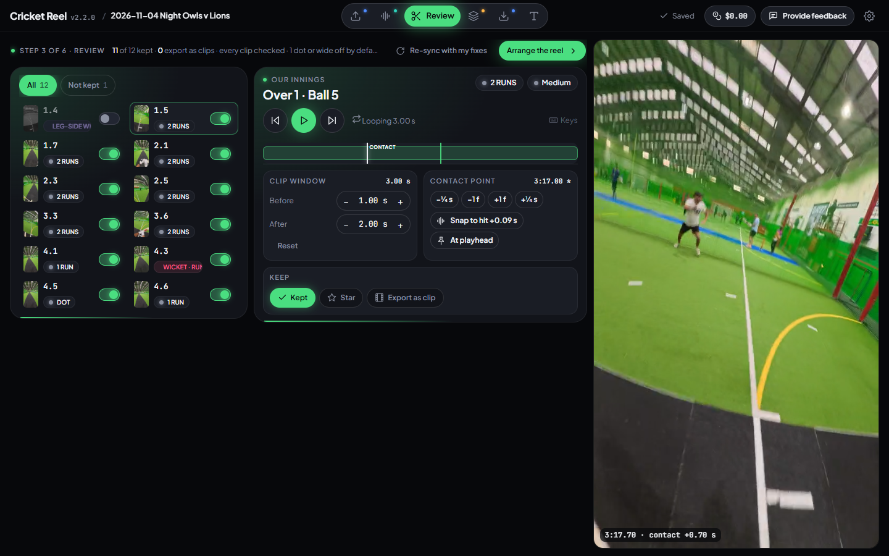
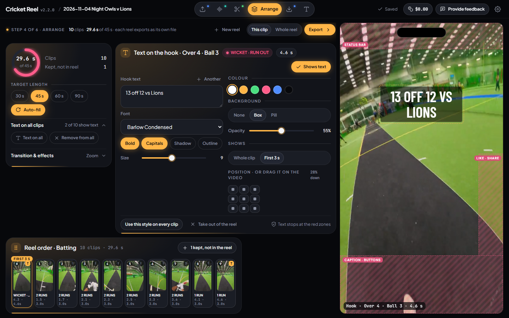
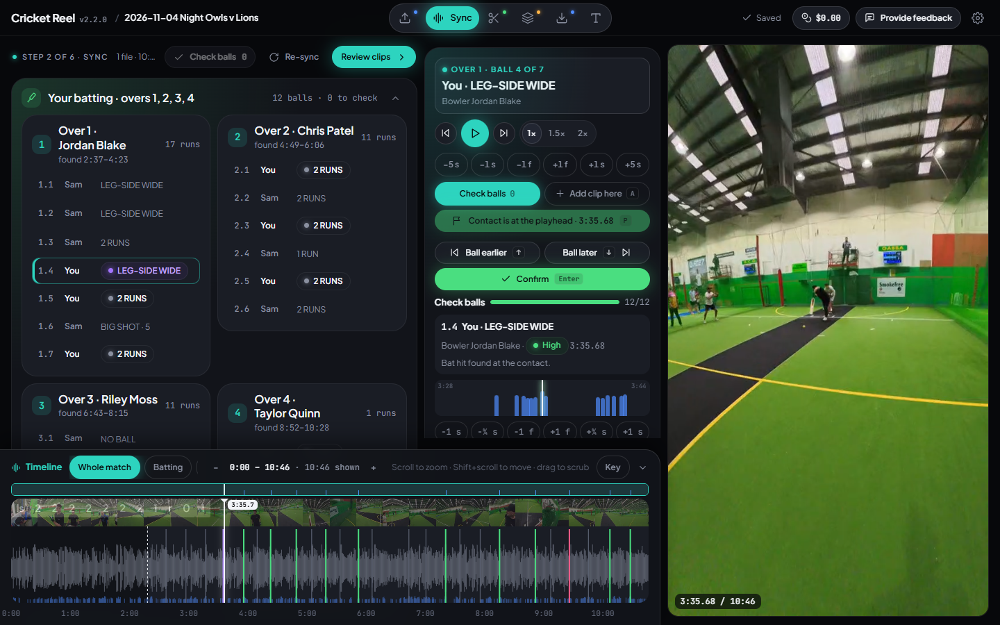

# Cricket Reel

Turn indoor cricket head-cam footage into highlight reels, on your own laptop.

I play indoor cricket and film every game on a head-mounted camera. Cutting the highlights by hand took longer than the
game itself, so I built this. It reads the match's score sheet, finds every ball I faced from the sound of bat on ball,
finds every wicket we took from the sheet order and the celebration after it, and cuts a clip for each. Then I pick,
arrange, export and caption the reels.

It was built for exactly how I play and post, so it makes assumptions (Spawtz score sheets, a Windows laptop, 9:16
reels for Instagram, TikTok and YouTube Shorts). I'm sharing it in case it's useful, or a good starting point for your
own version.



## What it does

Six steps, one screen each:

| Step | |
|---|---|
| **Import** | Add the match video files and paste the Spawtz score sheet link (or a photo of the sheet, read by Claude). Pick the reel: Batting, Bowling + Fielding or All-round. |
| **Sync** | Lines up every ball on the sheet with the video. Batting from bat-hit sounds; wickets from the ball order and the noise after them. Check anything it's unsure of. |
| **Review** | One clip per ball or wicket. Keep, star, trim, move the contact point, mark clips to export on their own. |
| **Arrange** | Build the reel: hook first, target length, auto-fill, transitions, text on each clip that stays clear of the app buttons. |
| **Export** | One 1080×1920 H.264 file per reel or clip, loudness-normalised, ready for every platform. |
| **Describe** | Claude drafts the caption, TikTok text and YouTube Shorts title for each file. |





Video never leaves the laptop. Only a score sheet photo (if you use one) and the caption prompts go to the Claude API.

## Run it

Windows 10/11 with Python 3.11+ and FFmpeg:

```
winget install -e --id Python.Python.3.12
winget install -e --id Gyan.FFmpeg
```

Then double-click **start.bat**. The first run sets up a virtual environment, installs the pinned packages and downloads
the fonts; the app opens at http://127.0.0.1:8000. Paste a Claude API key in **Settings** if you want photo score sheets
or captions (Spawtz links need no key). `build_desktop.bat` packages it as a desktop app with an installer.

Tests: `pip install -r requirements-dev.txt`, then `python -m pytest -q`.

Stack: Python (FastAPI), plain JavaScript, HTML and CSS, FFmpeg, NumPy/SciPy for the audio, the Anthropic API, and
pywebview + PyInstaller for the desktop build.

## How it was made

I built it with [Claude Code](https://claude.com/claude-code), one feature at a time: describe what I wanted, review a
clickable prototype, then have Claude build it, test it and open a pull request, and try it on the next real match.

Three ways to use this repo:

1. **Use it as it is** if you play indoor cricket on Spawtz sheets and film on a head cam.
2. **Fork it and change it** for your sport, sheet format or camera.
3. **Build your own with Claude Code.** You don't need this code at all. A first prompt like this gets you going:

> I film my sport on a head-mounted camera and want highlight reels without editing by hand. Build a local Windows app
> (Python backend, plain web frontend, FFmpeg) that takes the match video and the score sheet, finds each moment I care
> about from the audio and the sheet, cuts a clip for each, lets me review and reorder them, and exports 9:16 reels for
> Instagram, TikTok and YouTube Shorts. Keep the video on my laptop. Start with a clickable prototype of the screens so I
> can review it before you build anything, then build it in small phases with tests.

Then keep going one step at a time: try it on a real match, note what's wrong, ask for the fix.

## Licence

MIT. See [LICENSE](LICENSE). Fonts are downloaded at setup under the SIL Open Font Licence.
